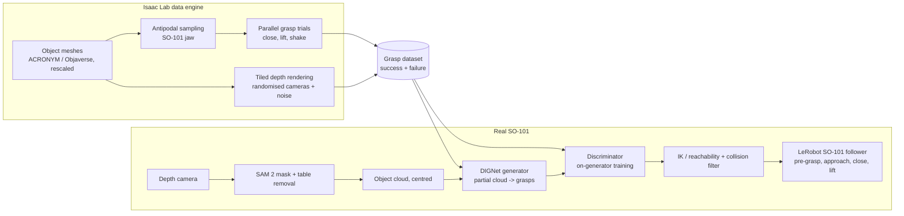

# Roadmap from DIGNet to sim-trained SO-101 grasping

## Target system

## Tiers

Pick the tier that fits the available time; each tier ends with a working, demonstrable result.

### Tier 1: 2 days, "fixed DIGNet on partial clouds"

| Day | Work | Output |
|---|---|---|
| 1 | Set up environment on the GPU machine, run `pytest tests`, train the fixed baseline (8 objects x 32 grasps, float64 as is) on a subset of ACRONYM, evaluate with 100 samples/object | Baseline numbers (coverage@3 cm, precision, recall Chamfer) with the new metrics |
| 2 | Train with `random_rotation: true, partial_view_prob: 0.5, jitter_sigma: 0.002`; build a partial-view test split; compare. Visualise grasps on partial clouds | Table full vs partial, figures, short write-up in this vault |

### Tier 2: 5 days, "sim-verified SO-101 grasps"

| Day | Work | Output |
|---|---|---|
| 1-2 | Tier 1 | |
| 3 | Isaac Lab: SO-101 gripper asset (measured geometry), free-floating gripper grasp trial env, antipodal sampler, run on ~500 objects | SO-101 grasp dataset in DIGNet npz format ([[state/ideas#I-09 SO-101 gripper grasp dataset from simulation]]) |
| 4 | Train DIGNet on the SO-101 dataset with partial-view augmentation; Isaac Lab evaluator measures success rate of generated grasps ([[state/ideas#I-08 Simulation based grasp success evaluation]]) | Sim success rate vs dataset / random baselines |
| 5 | Discriminator on positives, negatives and generator samples; rank top-k ([[state/ideas#I-06 Grasp discriminator trained on generator samples]]) | Success rate with and without discriminator |

### Tier 3: 10 days, "sim-to-real on the SO-101"

| Day | Work | Output |
|---|---|---|
| 1-5 | Tier 2 | |
| 6 | Rendered single-view depth from Isaac Lab tiled cameras with noise model, retrain on rendered clouds ([[state/ideas#I-03 Train on rendered partial views]]) | Model trained on sensor-like clouds |
| 7 | Real setup: depth camera mount, intrinsics, hand-eye calibration, SAM 2 segmentation, table plane removal; LeRobot calibration of the SO-101 | Real object clouds in the robot base frame |
| 8 | Execution: IK for the 5-DoF arm, reachability filter ([[state/ideas#I-10 Reachability-aware sampling for a 5-DoF arm]]), pre-grasp/approach/close/lift through LeRobot, record episodes as a LeRobot dataset | First real grasps |
| 9 | Evaluation: 10 to 15 household objects x 5 trials, two configurations (with/without discriminator or sim-rendered vs HPR-augmented training) | Real success-rate table, failure analysis |
| 10 | Buffer, clean-up ([[state/ideas#I-15 Clean-up and packaging]]), demo video, results in this vault | Reproducible pipeline and documented results |

Optional replacements if time allows: flow matching instead of DDPM ([[state/ideas#I-04 Flow matching on SE(3)]]), PTv3/PointNeXt encoder ([[state/ideas#I-05 Stronger point cloud encoder]]), closed-loop residual policy ([[state/ideas#I-14 Closed-loop refinement policy in Isaac Lab]]).

## Success criteria

- Sim: success rate of top-1 ranked grasp on held-out objects, SO-101 gripper, partial clouds. Report against (a) random antipodal grasps, (b) generator without discriminator.
- Real: success = object lifted 10 cm and held for 3 s. Report per object and overall, with the number of trials.
- Latency: perception + generation + ranking under 1 s on the GPU machine.

## Risks

| Risk | Mitigation |
|---|---|
| Isaac Lab setup and asset tuning eat the schedule | start from LeIsaac / Isaac Lab SO-101 assets; keep a pure-geometry fallback (antipodal + collision check labels) |
| SO-101 gripper geometry differs from the asset | measure jaw width, stroke, finger length on day 3 |
| 5-DoF reachability rejects most grasps | restrict the object workspace in front of the base; condition sampling on the base direction |
| Calibration errors dominate real failures | verify hand-eye with a touch test before grasping; add a 1 to 2 cm pre-grasp standoff |
| Python/CUDA mismatch between DIGNet and Isaac Lab | separate environments exchanging npz files, or modernise DIGNet first ([[state/ideas#I-12 Modernise the environment]]) |
| Light objects slip in sim but not real (or vice versa) | randomise friction and mass, keep grasps robust across randomisations |
