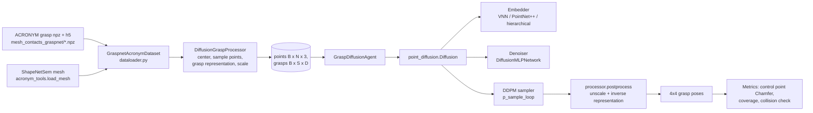

# Architecture

## Data flow

## Module map

| Layer | Path | Role |
|---|---|---|
| Entry | `diffusion/training.py` | Hydra main: seeds, float64 default dtype, wandb init, instantiates workspace and agent, calls `agent.train_agent` |
| Entry | `diffusion/evaluation.py` | Loads a run's `.hydra/config.yaml` from a hard-coded path, visualises the backward diffusion trajectory |
| Workspace | `diffusion/workspaces/diffusion_grasp_workspace_manager.py` | Builds train/test datasets via `dataset_fn` and wraps them in DataLoaders |
| Dataset | `diffusion/environments/diffusion_grasp/dataloader.py` | `GraspnetAcronymDataset`: splits files 98/2, train items are (object, sub-batch of grasps), test items are (object, all successful grasps) |
| Processor | `diffusion/processors/diffusion_grasp_processor.py` | Centres the mesh, shifts grasps to the finger centre, samples a point cloud, converts grasps to a vector representation, scales, augments (new) |
| Helpers | `helper/representation.py`, `helper/scaler.py`, `helper/sampler.py`, `helper/transform.py`, `helper/augmentation.py` (new) | Grasp parameterisations, dataset statistics scaling, point sampling, frames, augmentation |
| Agent | `diffusion/agents/diffusion_agents/grasp_diffusion_agent.py` | Training loop, evaluation, EMA, checkpointing, visualisation |
| Model | `diffusion/networks/diffusion/point_diffusion.py` | DDPM with an embedder and a denoiser network, used by `diffusion_grasp_agent` |
| Model | `diffusion/networks/diffusion/embedder_free_diffusion.py` | DDPM whose denoiser is a PointNet++ that sees the point cloud in the frame of the noisy grasp |
| Networks | `diffusion/networks/diffusion/diffusion_models.py` | `DiffusionMLPNetwork` (residual MLP over `[x, t_emb, cond]`) and unused attention variants |
| Encoders | `diffusion/networks/vision_encoder/*.py` | PointNet++ MSG, hierarchical PointNet++ (per diffusion step features), Vector Neuron PointNet, gripper-centric diffusion PointNet++ |
| Metrics | `helper/losses.py`, `helper/collision.py` | Control point Chamfer distance, gripper/point cloud collision and "object between fingers" checks |
| Visualisation | `helper/visualize.py` | Open3D / trimesh scenes with gripper markers |
| Dataset tools | `tools/`, `utils/` | Contact-GraspNet style scene generation and rendering (not used by training) |
| Object embeddings | `object_representation/` | Pre-computes Point-MAE / PointNeXt embeddings for a "pre-embedding" agent variant (OpenPoints vendored) |
| Legacy | `diffusion/agents/diffusion_agents/{k_diffusion,edm,guided,vision}*`, `diffusion/networks/{k_diffusion,edm_diffusion}`, `diffusion/agents/samplers` | Code from an earlier goal-conditioned play-data project (Franka kitchen, block push). Not wired to grasping configs |

## Grasp frame conventions

- Meshes are centred at the vertex mean (`Transform.start_transform`).
- ACRONYM grasp poses are given at the Panda wrist; the processor right-multiplies a +0.11217 m z offset, so the learned pose is the **finger centre** frame (approach axis = z, closing direction = x).
- The control points used by metrics (`helper/gripper_control_points/panda.npy`) are 10 symmetric pairs on the two fingers (x = ±0.0527 m, z = 0.075 to 0.105 m). Their z values match the **wrist** frame, but they are applied to finger centre poses, so in the metric they sit about 0.11 m further along the approach axis than the real fingertips. Distances stay consistent, but rotation errors are weighted more strongly than with the true geometry, see [[state/problems#P-14 Control points and grasp frame do not match]].

## Key design choice

The model learns the **distribution of successful grasps** only (no negatives, no discriminator). Generated grasps are not scored, so quality depends entirely on sample fidelity. See [[state/ideas#I-06 Grasp discriminator trained on generator samples]].
